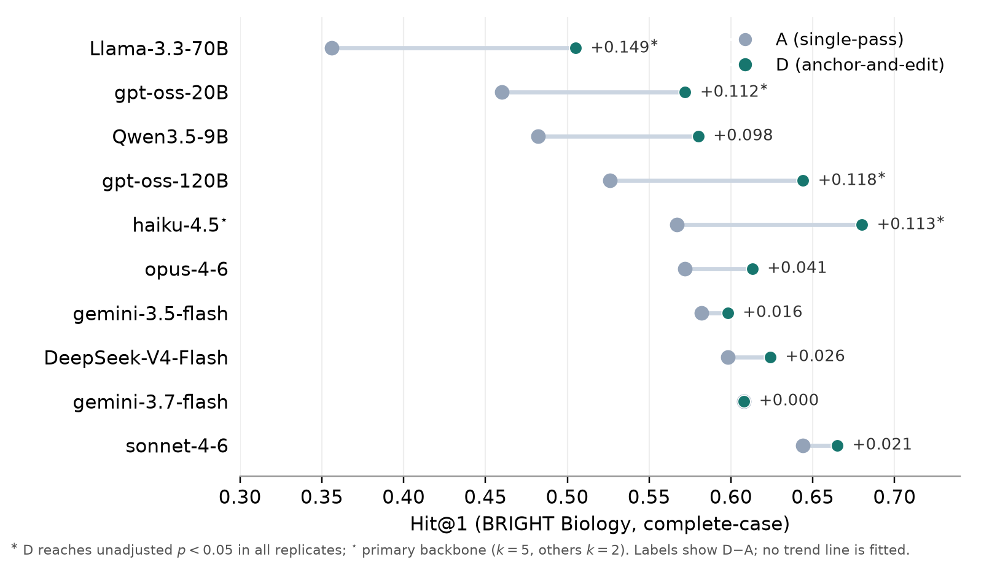
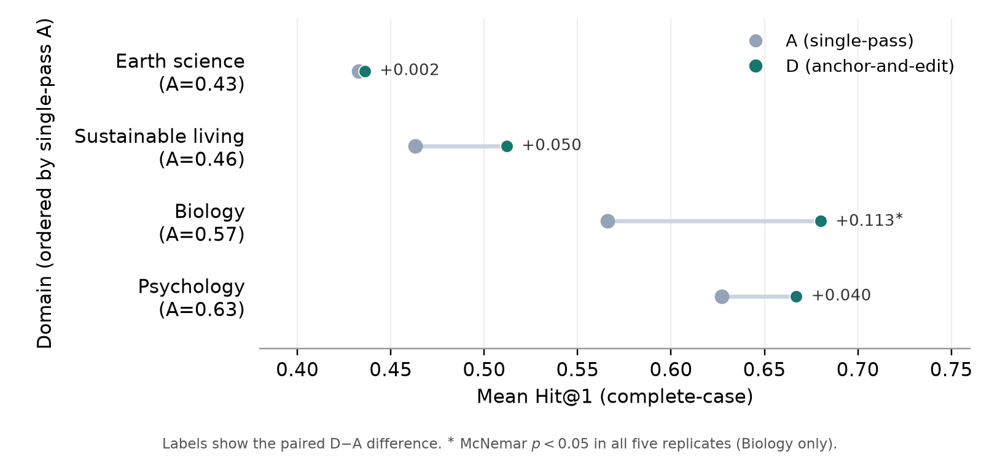

# Anchor-and-Edit: Bounded Revision for Agentic Document Ranking

**MSc dissertation, UCL Department of Computer Science (MSc AI for Sustainable Development), September 2026**
Erin Ju · Supervisor: Andrea Karlova

📄 **[Read the full dissertation (PDF)](report/Erin_Ju_MSc_Dissertation_Anchor_and_Edit.pdf)**

---

## Summary

**The question.** When a language model ranks documents for relevance, does coordinating several model calls ("agentic" designs) produce better rankings than asking the model once? And if it does, is the gain worth the extra cost?

**The motivation.** Matching research proposals to suitable funding calls needs judgements about scientific fit, eligibility and context that keyword search handles poorly. This project tests whether agentic coordination helps with that kind of judgement.

**The approach.** Four ranking designs were compared under identical conditions (same candidates, same model, same relevance objective):

| Design | How it works | Model calls |
|---|---|---|
| **A** Single pass | The model ranks all candidates once | 1 |
| **B** Concept first | Abstract the query into concepts, then rank | 2 |
| **C** Alternative interpretation | Rank under competing readings of the query, then reconcile | 3 |
| **D** Anchor and edit *(proposed)* | Keep A's ranking as an anchor and promote at most two candidates | 4 |

The idea behind **anchor and edit** is to fix specific ranking errors without throwing away an ordering that is mostly right.

The designs were evaluated in two studies:

* **Study 1: public benchmark.** Reranking on [BRIGHT](https://github.com/xlang-ai/BRIGHT), a reasoning intensive retrieval benchmark, across four domains, ten model backbones, five replications, with component ablations, a call matched control and lexical (BM25) and neural (cross encoder) baselines.
* **Study 2: applied task.** Matching six research proposals to six funding calls (36 pairs), scored against a domain expert's relevance judgements.

## Key findings

1. **All four LLM designs beat the BM25 and cross encoder baselines** on the evaluated BRIGHT pools.
2. **Anchor and edit gave the best ranking on Biology**, raising the share of queries with a relevant document ranked first from **56.6% to 68.0%** on the main backbone, significant in all five replications. It made about 3.5 corrections for every correct ranking it disrupted.
3. **The gain is setting dependent.** It was clearest where the single pass baseline left recoverable errors near the top: large for weaker models, small for the strongest ones, and not consistent across all domains.
4. **On the applied matching task, no design clearly improved ranking.** With only six candidates and a strong baseline there was little room to correct. All designs agreed with the expert about as closely as a second human annotator using the same rubric.
5. **Extra calls on their own did not help.** Repeating the single pass four times used more tokens than anchor and edit and performed no better than one pass (anchor and edit's lead over this control was positive but not statistically resolved).

**Takeaway:** bounded revision is a useful, low disruption way to spend extra model calls when the first ranking has fixable errors, but it is not a universal improvement and needs larger scale validation.

<p align="center">
  
  <br><em>Single pass (A) vs anchor and edit (D) on BRIGHT Biology across ten backbones. Gains are largest where the baseline is weaker.</em>
</p>

<p align="center">
  
  <br><em>A vs D across four BRIGHT domains on the main backbone (five replications).</em>
</p>

Full results, statistical tests, error analysis, cost profile and limitations are in the [report](report/Erin_Ju_MSc_Dissertation_Anchor_and_Edit.pdf).

---

## Repository layout

```
report/    final dissertation (PDF)
figures/   key result figures used in this README
scripts/   all experiment code (runners, model clients, scorers)
configs/   experiment configuration
docs/      experiment design, competing hypotheses design, freeze notes,
           pre-registration, cross-study summary
```

## Key scripts

**Study 1: BRIGHT reranking (public benchmark)**
- `scripts/bright_backbone.py`: A/D prompts and pool loading for BRIGHT.
- `scripts/bright_backbone_bc.py`: adds the B and C arms.
- `scripts/bright_clean_split.py`: parity clean A/B/C/D on any domain or backbone.
- `scripts/panel_ad.py`: cross model A/D panel (open models via the OpenAI compatible client).
- `scripts/bright_bm25_baseline.py`, `scripts/bright_crossencoder_baseline.py`: reference lexical and neural rerankers.
- `scripts/bright_anchor_visibility.py`: anchor visibility perturbation check (hidden vs visible anchor × correct vs degraded ranking).
- `scripts/score_*`: scoring and analysis.

**Study 2: applied proposal to funding call matching**
- `scripts/study2_match.py`, `scripts/study2_match_listwise.py`: listwise A/B/C/D matcher.
- `scripts/study2_decomposed.py`, `scripts/study2_dependency.py`: decomposed and information dependency probes (appendix material, not the main Study 2 numbers).
- `scripts/rq2_core.py`: provider routing, clients, cost accounting.
- `scripts/oai_client.py`: provider agnostic OpenAI compatible client for open weight models (Together / Fireworks / Groq / …).
- `scripts/score_study2_listwise*.py`: metrics against the expert reference labels.
- `scripts/bootstrap_study2_kappa.py`: bootstrap 95% CIs for agreement κ.

## Data availability

- **Study 1 (BRIGHT)** is a public benchmark (Su et al., 2025; https://huggingface.co/datasets/xlangai/BRIGHT). The candidate pools are derived from it. Large data files are not committed; see the script paths under `data/` to reconstruct them.
- **Study 2 (applied)** uses **proprietary, non public partnering data** that is **not included**. Scripts read the withheld expert labels and document texts from paths under `data/study2_validation/`, overridable with environment variables (`STUDY2_GOLD_CSV`, `STUDY2_ANNOTATION_CSV`, `DOCS_FILE`). The code is provided for transparency of method, not to redistribute the data.

## Setup

```bash
python3 -m pip install -r requirements.txt
cp .env.example .env    # then fill in your own API keys
```

`requirements.txt` lists the core dependencies (lower bounds, not a lockfile). Optional extras for auxiliary scripts (cross encoder baseline, headroom analyses, figure regeneration) are noted there.

Set the keys you need in `.env` (never commit real keys):

```
ANTHROPIC_API_KEY=...
GOOGLE_API_KEY=...
TOGETHER_API_KEY=...        # open weight models
OAI_BASE_URL=https://api.together.xyz/v1
OAI_API_KEY_ENV=TOGETHER_API_KEY
```

## Experimental settings

- Main backbone: the pinned `claude-haiku-4-5-20251001` snapshot.
- Decoding is temperature 0 where settable; reasoning capable open weight models run with `enable_thinking=false` for parity with the direct answer closed models.
- Study 1 uses five replications; Study 2 uses a single presentation order seed (42) for the main comparison and panel.
- Seeds control candidate presentation order only and are not passed to the provider, so runs are not bit reproducible from a seed alone.

## Reproducibility scope

The **dissertation pipeline** is the set of scripts under *Key scripts* above (BRIGHT `bright_*` reranking and baselines, `panel_ad.py`, and the `study2_*` / `score_study2_*` matching and scoring). These produce the reported Study 1 and Study 2 results.

Other files are **earlier exploratory work retained for provenance** and are **not** part of the reported results: the `rq2_*` architecture scripts, the CORDIS data utilities (`clean_cordis_data.py`, `cordis_tfidf_poc.py`, `configs/experiment_config.json`), the LangGraph / FastAPI prototypes (`rq2_single_agent_langgraph_baseline.py`, `retrieval_api.py`), the TREC CT probes, and the early BRIGHT MVPs (`bright_mvp.py`, `bright_concept_mvp.py`). They may use different datasets, models or heavier dependencies. `docs/EXPERIMENT_FREEZE.md` documents the frozen, model independent inputs (§§1–4); §5 records the final backbone.

## Citation

```bibtex
@mastersthesis{ju2026anchoredit,
  author = {Ju, Erin},
  title  = {Anchor-and-Edit: A Controlled Evaluation of Bounded Revision for Agentic Document Ranking},
  school = {University College London},
  year   = {2026},
  type   = {MSc dissertation},
  url    = {https://github.com/erinju7/agentic-ranking-bounded-revision}
}
```
